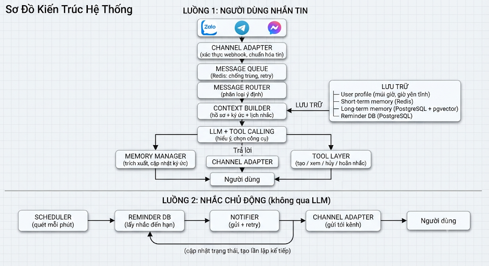

```text
AI-assistant/
│
├── app/
│   ├── main.py
│   │
│   ├── api/
│   │   ├── routes.py
│   │   └── schemas.py
│   │
│   ├── channels/
│   │   ├── base.py
│   │   ├── telegram.py
│   │   ├── zalo.py
│   │   └── messenger.py
│   │
│   ├── conversation/
│   │   ├── router.py
│   │   ├── handler.py
│   │   └── context_builder.py
│   │
│   ├── agents/
│   │   ├── assistant.py
│   │   └── research.py
│   │
│   ├── memory/
│   │   ├── manager.py
│   │   ├── extractor.py
│   │   └── retriever.py
│   │
│   ├── research/
│   │   ├── search.py
│   │   ├── collector.py
│   │   ├── filter.py
│   │   └── summarizer.py
│   │
│   ├── reminders/
│   │   ├── service.py
│   │   ├── scheduler.py
│   │   └── notifier.py
│   │
│   ├── database/
│   │   ├── connection.py
│   │   ├── models.py
│   │   └── repository.py
│   │
│   └── core/
│       ├── config.py
│       ├── llm.py
│       └── queue.py
│
├── prompts/
│   ├── assistant.md
│   ├── research.md
│   └── summarizer.md
│
├── tests/
│
├── scripts/
│
├── .env.example
├── .gitignore
├── requirements.txt
├── Dockerfile
├── docker-compose.yml
└── README.md
```
